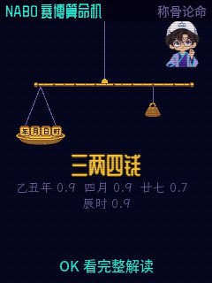

# NABO 赛博算命机

FoloToy AI Passport 工牌上的离线娱乐固件。ESP32-C3、8 MB Flash、240×320 竖屏，开机由 NABO 道长迎接，无需配网。

**首个公开版本：[v0.1.2](https://github.com/Liutupi/nabo-fortune/releases/tag/v0.1.2)** · [下载固件](https://github.com/Liutupi/nabo-fortune/releases/latest) · [刷机说明](docs/FLASHING.md) · [真机验收](validation/M4-device.md)

  

上图为固件 C 渲染器生成的界面预览，原尺寸 240×320。

## 玩法

| 玩法 | 内容 |
|---|---|
| 今日一卦 | 星座、塔罗、灵签、卦象合成今日小票 |
| 摇卦问事 | 三枚铜钱六次成卦，变爻断法与完整解读 |
| 灵签筒 | 长按摇签，掉签、卷轴、签诗与白话 |
| 塔罗 | 22 张原创 NABO 大阿卡纳，洗牌、选牌、抽出与翻面 |
| 称骨论命 | 年月日时四块砝码、秤砣称重、白话/原诗/明细三页 |
| 星座 | 连星成座，四项星级与幸运数字、颜色 |
| 紫微斗数 | 十二宫、主辅星与分宫解读 |
| 奇门遁甲 | 拆补法排盘、飞宫动画与问事解读 |

生辰档案保存在 NVS。正文 16 px，辅助提示至少 14 px；开机播放“NABO，在此恭候”。全部结果仅供娱乐。

## 操作

- 上、下选择，OK 确认；双击上键返回主转盘。
- 摇卦、摇签：按住 OK，再松开。
- 解读页：上下翻页；称骨称完后停留，按 OK 查看完整解读。
- 塔罗抽出约 1.2 秒、停顿 0.6 秒、翻面 1.4 秒，牌面保留到再次按 OK。
- 无操作五分钟自动休眠，上键唤醒。断电重开保留生辰，时间需要重新校准。

## 安装

这是独立固件，会替换设备原有程序。请先备份。首次切换请使用完整安装；已有相同算命机分区布局时可用保留 NVS 的升级模式。

1. 下载 Release 的 ZIP 和 SHA256SUMS.txt，核对校验值并解压。
2. 网页工具的“本地固件刷机”可选择 `nabo-fortune-v0.1.2-full.bin`，地址为 **0x0**，执行完整安装。
3. 或使用 ZIP 内的 `flash_release.py`，按 [刷机说明](docs/FLASHING.md) 核对 MAC、备份和安装。

不能套用小智版或单词护照的素材偏移。本项目 assets 在 **0x200000**。发布包不含用户 NVS、设备备份或个人档案。

## 源码和全部原始资源

- `firmware/`：独立 ESP-IDF 5.5.3 工程。
- `prototype/`：可离线打开的浏览器原型；运行根目录“打开原型.bat”。
- `game-art/fortune/`：NABO 身份基准、造型、Grok 起始图、原始 v1/v2 视频、道具、22 张牌及原始大图、字体点阵和文本来源。
- `tools/fonts/`：源字体和 OFL 许可；其他工具负责抽帧、字体、素材包和发行打包。
- `tests/`、`validation/`：逻辑对拍、渲染回归和脱敏真机记录。

```powershell
python tools/pack_assets_fortune.py
./firmware/tools/build.ps1 -Action all
```

构建环境、离线组件配置见 [firmware/README.md](firmware/README.md)，测试步骤见 [tests/README.md](tests/README.md)。Windows 宿主测试不带 ASan/UBSan。重新生成逻辑表需要 `npm install`；排盘依赖的版本固定在 package.json。

## 验证与边界

已在工牌验证八玩法流程、十二场景十轮切换、个人档案断电保留、五分钟休眠和上键唤醒。用户已接受牌面/动画、称骨、声音和字号复测。7831 帧宿主增量/整屏一致；全部 22 张牌可解码，长名牌面反复读取不再造成部件消失。

摇签仍有少量慢帧，NABO 原视频素材为 12 fps；具体耗时、内存与验证范围见验收记录。休眠时 USB 端口未消失、启动早期复位日志未捕获，使用实际熄屏/上键恢复、运行时间重新计时和时钟连续性作为功能验收依据。

## 许可

自有程序源码 MIT。NABO 形象及美术、视频、音频不随 MIT 授权；第三方字体与程序保留各自许可。见 [NOTICE.md](NOTICE.md)、[THIRD_PARTY_NOTICES.md](THIRD_PARTY_NOTICES.md)。本项目与 FoloToy 官方无关联。
