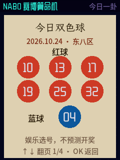

<p align="right"><strong>简体中文</strong> · <a href="README.md">English</a></p>

# NABO 赛博算命机

FoloToy AI Passport 工牌上的离线娱乐固件。ESP32-C3、8 MB Flash、240×320 竖屏；NABO 开机迎接，无需配网。

**[v0.1.3 固件](https://github.com/Liutupi/nabo-fortune/releases/tag/v0.1.3)** · [下载](https://github.com/Liutupi/nabo-fortune/releases/latest) · [刷机说明](docs/FLASHING.zh_CN.md) · [发布说明与验证](docs/RELEASE_v0.1.3.zh_CN.md)

 

上图来自固件宿主渲染器，原尺寸 240×320，使用公开示例档案。号码仅供娱乐，不是开奖预测。

## 玩法

| 玩法 | 内容 |
|---|---|
| 今日一卦 | 星座、塔罗、灵签和卦象合成每日小票；上下键还可选择**今日双色球** |
| 今日双色球 | 每日固定一组：6 个不重复且升序的红球（01–33）与 1 个蓝球（01–16），可翻页查看个性化生成依据 |
| 摇卦问事 | 三枚铜钱六次成卦，变爻断法与完整解读 |
| 灵签筒 | 长按摇签、掉签、卷轴、签诗和白话 |
| 塔罗 | 22 张原创 NABO 大阿卡纳，洗牌、选牌、抽出和翻面 |
| 称骨论命 | 年月日时四块砝码、秤砣称重、白话/原诗/明细三页 |
| 星座 | 连星成座，四项星级、幸运数字和颜色 |
| 紫微斗数 | 十二宫、主辅星与分宫解读 |
| 奇门遁甲 | 拆补法排盘、飞宫动画和问事解读 |

全部结果仅供娱乐。双色球综合生辰、农历干支、每日小票、称骨、紫微及固定东八区 12:00 奇门盘；同日同档案重复查看、重启都保持一致。不能预测开奖，也不提高中奖概率；“今日”是日历日期，不是彩票期号。详见 [v1 规则](docs/DAILY_SSQ.zh_CN.md)。

## 操作与存储

- 上下选择，OK 确认；双击上键回主转盘。
- 摇卦、摇签使用 OK 按住和松开；解读页上下翻页。
- 今日一卦中选择“命签小票”或“今日双色球”，OK 打印。双色球结果页上下循环查看号码和依据，OK 返回两个选项。
- 塔罗抽出 1.2 秒，停顿 0.6 秒，翻面 1.4 秒；牌面保留到再次按 OK。
- 称骨结束停在杆秤，按 OK 查看完整解读。
- 生辰保存在 NVS，冷启动后需校准时间。五分钟无操作休眠，上键唤醒。
- 正文 16 px、提示至少 14 px；开机语音“NABO，在此恭候”。

## 安装与升级

独立固件会替换当前应用。下载 Release ZIP 和 SHA256SUMS.txt，核对后解压。分区兼容时使用 `upgrade`，只写应用和素材并保留 NVS。**0x0** 合并镜像可能覆盖 NVS 和 PHY，适用于明确的完整安装。备份是可选项；附带工具不会整片擦除。步骤见[刷机说明](docs/FLASHING.zh_CN.md)。

assets 分区在 **0x200000**，不能套用小智版或单词护照偏移。发布包不含用户 NVS、生辰、设备备份或原始串口日志。

## 源码、原始资源与构建

- `firmware/`：独立 ESP-IDF 5.5.3 工程。
- `prototype/`：离线浏览器原型；打开 prototype/index.html 或运行根目录 Windows 启动器。
- `game-art/fortune/`：NABO 身份、造型、Grok 起始图及原始 v1/v2 视频、道具、22 张牌及原始大图、字体点阵与文本来源。
- `tools/fonts/`：源字体及 OFL 许可；工具负责精灵、字体、素材与发行打包。
- `tests/`、`validation/`：逻辑对拍、渲染回归、脱敏设备证据。

```sh
npm install
python tools/pack_assets_fortune.py
# 激活 ESP-IDF v5.5.3；如果 IDF Python 缺宿主渲染库，可指定 HOST_PYTHON。
./tools/validate.sh
```

Windows 可用 firmware/tools/build.ps1。环境见 firmware/README.md，测试见 tests/README.md 及[双色球说明](docs/DAILY_SSQ.zh_CN.md)。固件不依赖 Node；package.json 固定开发机排盘和表生成依赖。Windows 原生宿主测试不带 ASan/UBSan。

## 验证与限制

本次增量通过 1,795 组 JS/C 对照、19 项变异检查、10,741 帧增量/整屏零差异、字形覆盖及离线浏览器按键/跨日/刷新测试。0.1.3-dev 工牌增量已完成写后校验、NVS 逐字节保留、串口流程和重启检查，用户确认实屏号码和三个实体键正常。正式镜像另行记录于 [v0.1.3 发布说明](docs/RELEASE_v0.1.3.zh_CN.md)，不将旧镜像验收挪给新镜像。

v0.1.2 基线覆盖八玩法、十轮场景切换、断电生辰保留和五分钟休眠唤醒。摇签仍有少量慢帧；原始 NABO 视频为 12 fps。本次增量未重新验证实体音质、休眠唤醒或功耗，不声称测过休眠电流。

## 许可

自有程序源码 MIT。NABO 形象、美术、视频和音频不随 MIT 授权；第三方字体与程序保留各自许可。见 [NOTICE](NOTICE.md)、[第三方说明](THIRD_PARTY_NOTICES.md)。本项目与 FoloToy 官方无关联。
