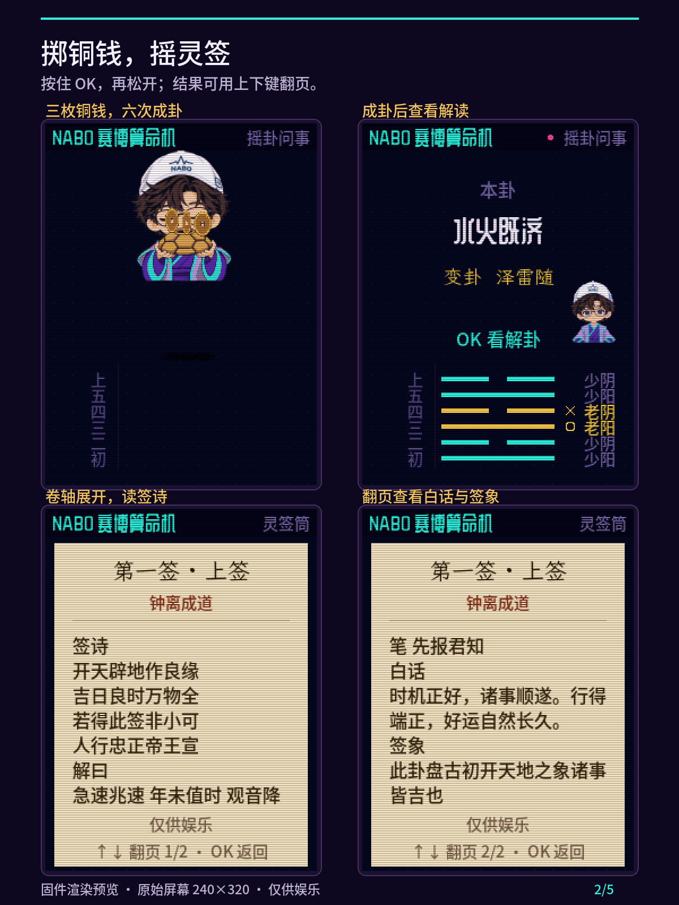
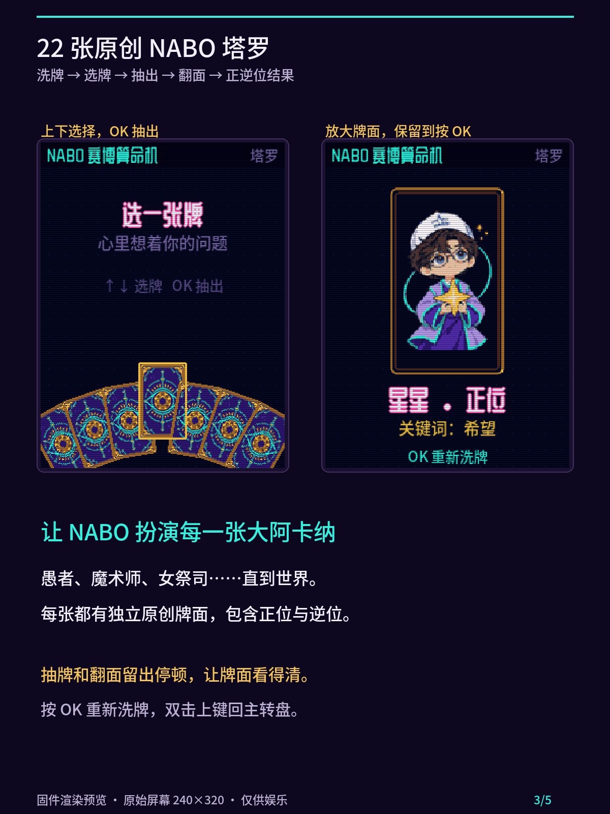
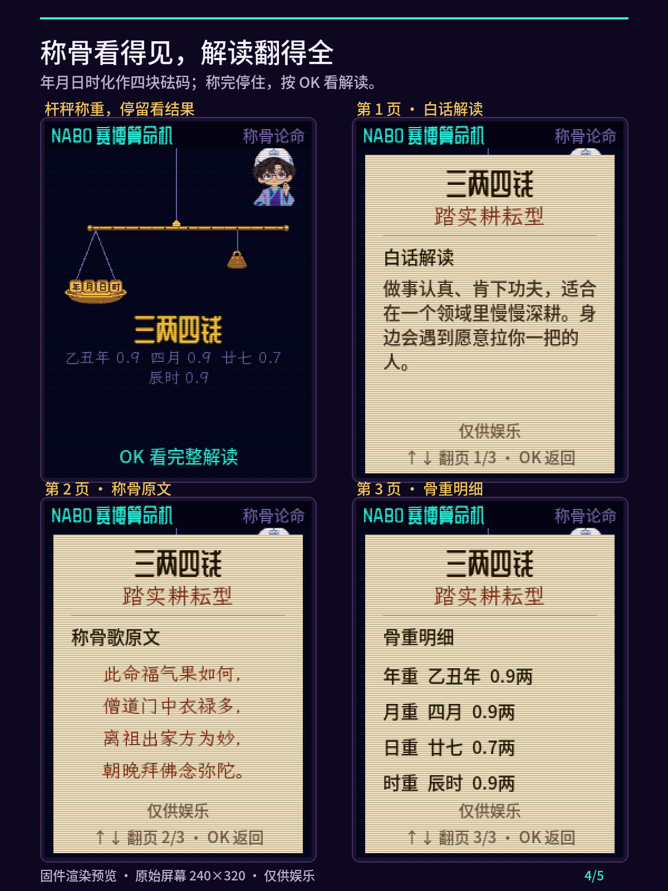
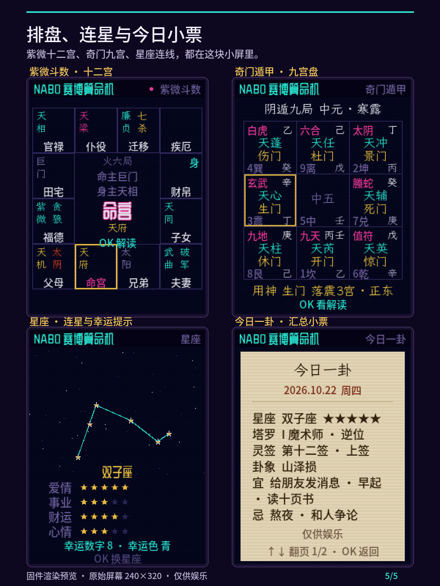
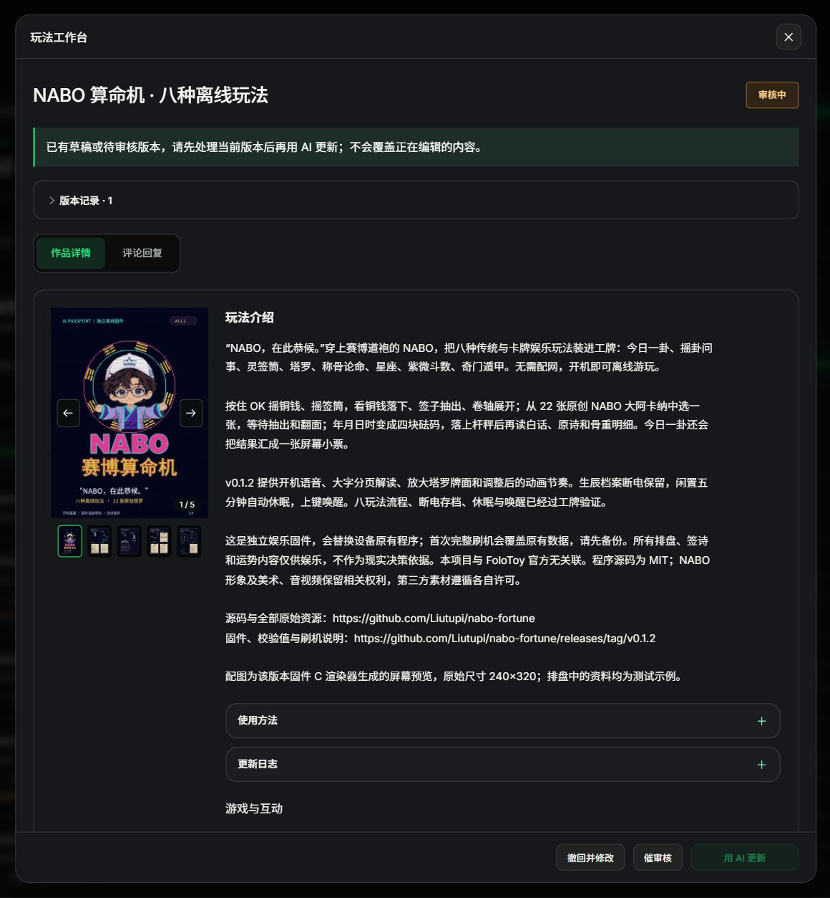

# NABO 算命机 v0.1.2 · 社区投稿素材

[完整介绍、使用方法、更新日志与投稿记录](submission.md)

2026-10-22 已提交 AI Passport 玩法社区，作品 ID **1498**，当前状态 **审核中**。封面按用户要求采用实际开机画面。此处记录的是提交结果，公开玩法链接需待审核通过。

5 张配图均为 1200×1600（3:4），来源于已验收版本的固件 C 渲染器；不是设备实拍。排盘资料为测试示例。运行 `python tools/prepare_community.py` 可重新组合配图。

| 封面 | 摇卦与灵签 | 塔罗 |
|---|---|---|
|  |  |  |

| 称骨解读 | 排盘与星座 |
|---|---|
|  |  |

## 提交凭据

固件沿用 [GitHub v0.1.2 完整镜像](https://github.com/Liutupi/nabo-fortune/releases/tag/v0.1.2)，未修改、重编译或重新打包。源码及本次投稿素材更新不移动 v0.1.2 标签。
